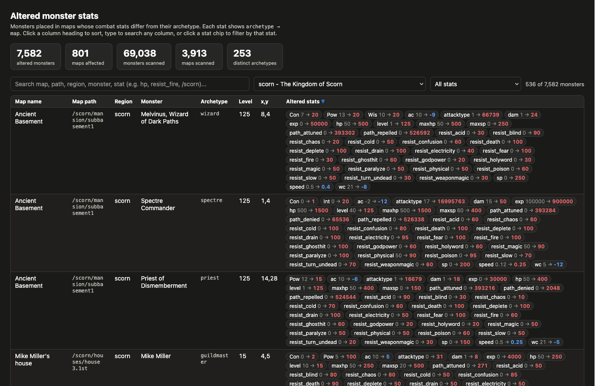

# Crossfire Monster Stat Audit

A searchable, sortable web page listing every monster in the Crossfire map set
whose stats differ from its archetype. A map object only stores the attributes
that differ from its archetype, so any combat stat written on a monster in a map
file with a different value is an alteration. This tool finds them all.



*The page opened with `?region=scorn&sort=nchg&dir=desc` (see
[URL parameters](#url-parameters)).*

Each row of the page shows:

| Column | Meaning |
| --- | --- |
| Map name | The `name` from the map header |
| Map path | Path of the map under the maps root, e.g. `/scorn/temples/sorig` |
| Region | The `region` from the map header (blank if none is set) |
| Monster | The monster's display name |
| Archetype | The archetype the monster is built from |
| Level | The monster's effective level (map value, else archetype value) |
| x,y | Location on the map |
| Altered stats | Each changed stat as `archetype value -> map value` |

The page supports sorting on any column, free-text search across all columns,
region and stat filters, and paging. Clicking a stat chip filters to that stat.

## Requirements

- Python 3 (standard library only)
- Checkouts of the Crossfire data repositories:
  - [crossfire-maps](https://sourceforge.net/p/crossfire/crossfire-maps/)
  - [crossfire-arch](https://sourceforge.net/p/crossfire/crossfire-arch/)

```
git clone https://git.code.sf.net/p/crossfire/crossfire-maps
git clone https://git.code.sf.net/p/crossfire/crossfire-arch
```

## Usage

```
python3 monster_stat_audit.py -m /path/to/crossfire-maps -a /path/to/crossfire-arch
```

This writes `index.html` next to the script (about 15 seconds on the full map
set). Open it directly in a browser, or serve it with `python3 -m http.server`.

| Option | Default | Purpose |
| --- | --- | --- |
| `-m`, `--maps` | `~/Documents/cf-devel/crossfire-crossfire-maps` | Maps checkout |
| `-a`, `--arch` | `~/Documents/cf-devel/crossfire-crossfire-arch` | Archetype checkout |
| `-o`, `--out` | `index.html` beside the script | Output page |
| `--json` | none | Also write the raw rows as JSON |

`index.html` is generated and is not tracked in git.

## Automatic publishing

`.github/workflows/pages.yml` clones the current maps and arch repositories,
regenerates the page and publishes it to GitHub Pages. It runs weekly (Mondays
06:17 UTC), on manual dispatch from the Actions tab, and when the script or
workflow changes. To enable it, set **Settings -> Pages -> Source** to
**GitHub Actions** in the repository.

## URL parameters

The page's state is kept in the URL, so a filtered or sorted view can be
bookmarked or shared.

| Parameter | Values | Example |
| --- | --- | --- |
| `region` | a region name | `?region=scorn` |
| `stat` | a stat name | `?stat=resist_fire` |
| `q` | search text | `?q=dragon` |
| `sort` | `map`, `path`, `region`, `monster`, `arch`, `level`, `xy`, `nchg` | `?sort=level` |
| `dir` | `asc` or `desc` | `?sort=nchg&dir=desc` |

Parameters combine: `index.html?region=scorn&sort=nchg&dir=desc`. Unknown
regions, stats or sort keys are ignored.

## What is compared

- Level and experience: `level`, `exp`
- Hit and spell points: `hp`, `maxhp`, `sp`, `maxsp`, `grace`, `maxgrace`
- Combat: `dam`, `wc`, `ac`, `speed`
- Character stats: `Str`, `Dex`, `Con`, `Int`, `Wis`, `Pow`, `Cha`
- Defences and attacks: `attacktype`, every `resist_*`
- Spell paths: `path_attuned`, `path_repelled`, `path_denied`

Names, faces, flags and carried items are not compared.

## Notes

- Monsters carried inside another object (spawn points, containers, other
  monsters) are included. Their location is the container's square, and the
  Monster cell notes the container.
- These map directories are skipped because they hold no playable maps:
  `editor`, `python`, `Info`, `styles`, `templates`, `test`, `animations`.
- Objects whose archetype cannot be found are skipped, and a count is printed.
- An alteration is not necessarily a bug. Most are deliberate tuning by map
  authors; the page is a review aid.

## License

GPL-2.0-or-later. See [LICENSE](LICENSE), which is the same GPL version 2 text
used by the Crossfire maps and archetypes. The generated page embeds data taken
from those repositories and is subject to their licenses.
